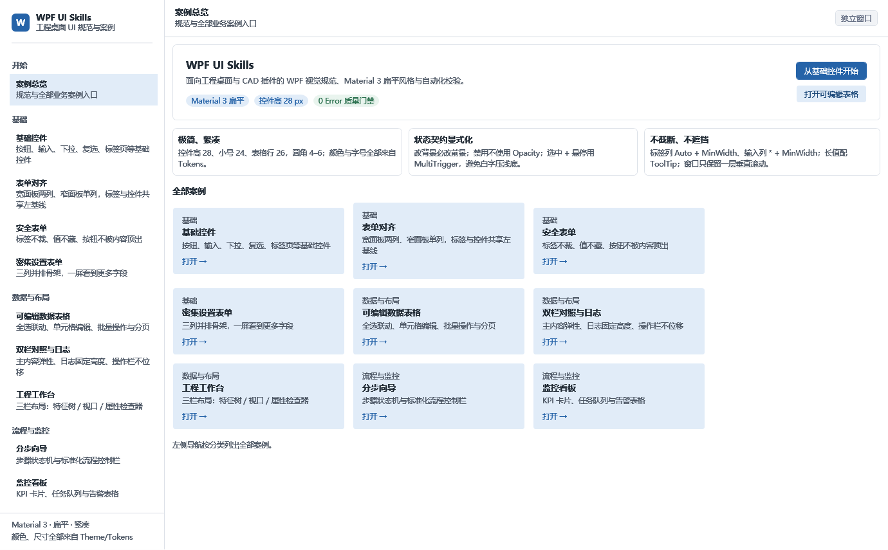
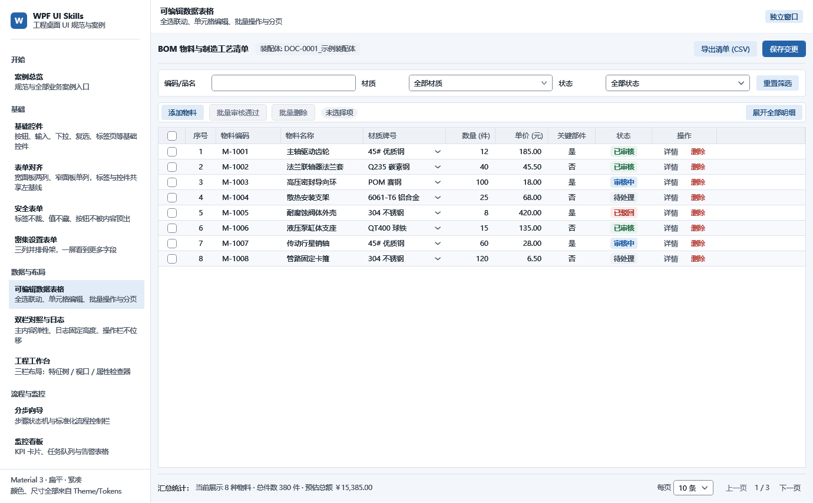
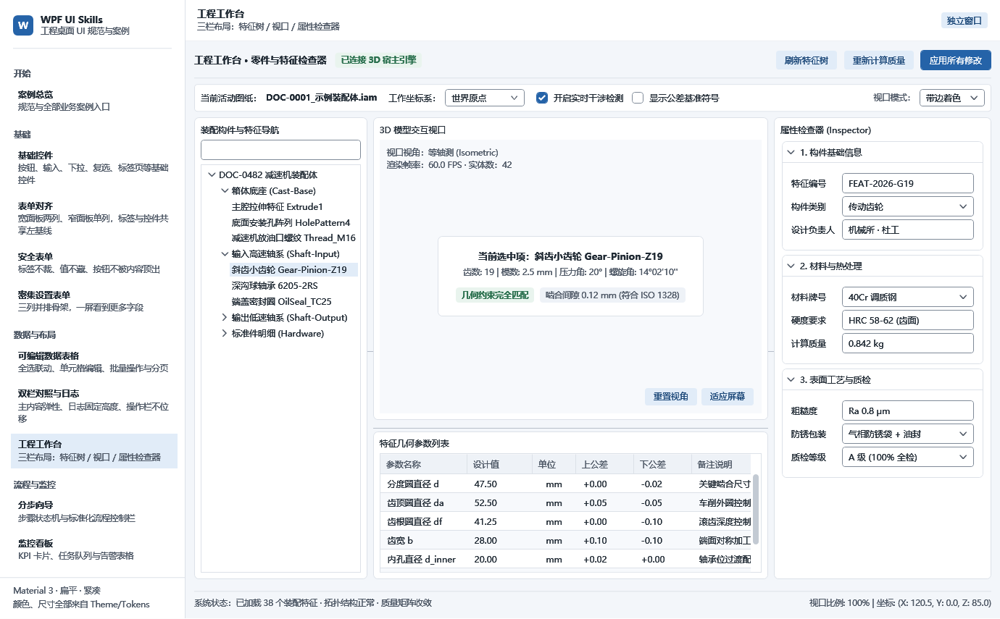
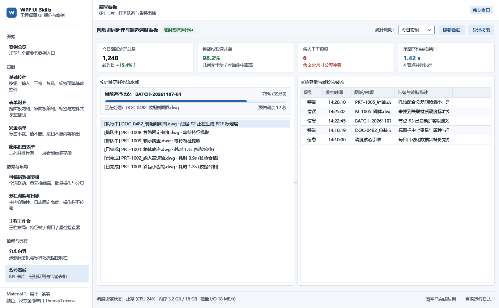
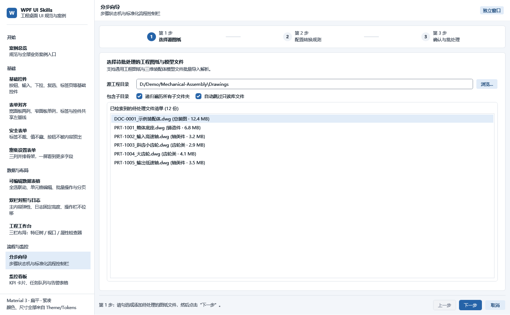
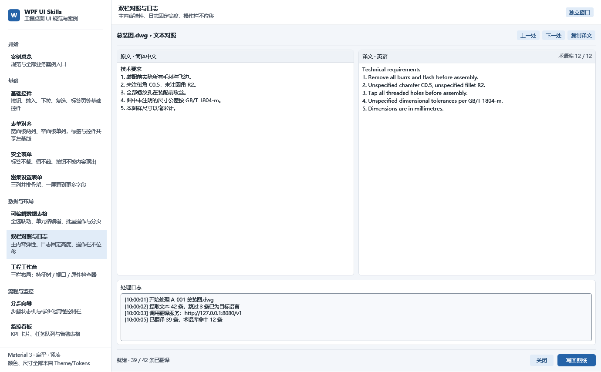
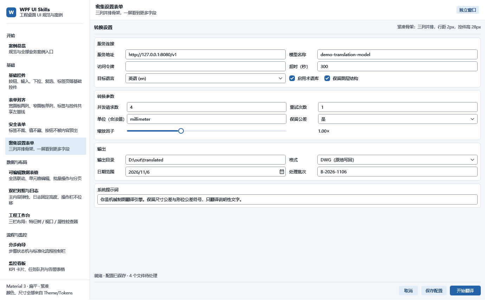

<h1 align="center">WPF UI Skills</h1>

<p align="center">A WPF/XAML design system, compact Material Design 3 theme, AI coding skill, and automated verification toolkit for desktop tools and engineering plugins.</p>

<p align="center">
  <a href="./README.md">English</a> | <a href="./README.zh-CN.md">简体中文</a>
</p>

<p align="center">
      <a href="./docs/README.md"></a>
</p>

`wpf-ui-style` packages executable WPF resource dictionaries, explicit foreground/background state contracts, anti-truncation layout rules, a runnable Preview Case Center, and static/runtime quality gates into one repository that works both as a drop-in WPF theme and as an installable AI agent skill (`SKILL.md`).

## Highlights

| Highlight | Why it matters |
|---|---|
| Compact flat Material Design 3 sizing | Single size profile (control height 28 / small 24 / large 32 px, table row 26 px, header 28 px, corner radius 4-6) driven by `{DynamicResource Layout.*}`; primary color `#2563A8`, secondary buttons use a tonal light-blue fill without outline. |
| Explicit control state contracts and WCAG AA contrast | Every state transition declares both `Background` and `Foreground`, bans `Opacity` for disabled states, and enforces contrast ratios (body text >= 4.5:1, borders/icons/disabled text >= 3:1) checked by `tools/ContrastCheck.py`. |
| Anti-truncation and stable-height layout rules | Prevents clipped labels, stretched multiline inputs, unclickable input whitespace, and `TabControl` height jumps in `SizeToContent="Height"` windows, enforced by `tools/LayoutCheck.py`. |
| Runnable Preview Case Center | Includes 10 interactive `UserControl` case views in `preview/Views`, supporting off-screen PNG rendering and DPI scale testing. |
| Automated quality gate and multi-client skill installer | Combines Python 3 standard-library static checks, xUnit contract tests (`tests/WpfStyleContractTests.csproj`), click-state UI tests (`tools/UiTest.py`), and `install.ps1` for major AI coding clients. |
| Zero third-party UI dependencies | Targets both .NET Framework 4.8 and .NET 8+ using standard WPF controls only, suitable for standalone desktop apps and host-embedded engineering plugins. |

## Architecture

```text
┌────────────────────────────────────────────────────────────────────────────┐
│                        AI Skill & Specification Layer                      │
│   SKILL.md   │   install.ps1   │   docs/   │   references/              │
└────────────────────────────────────┬───────────────────────────────────────┘
                                     │ guides & configures
                                     ▼
┌────────────────────────────────────────────────────────────────────────────┐
│                         Theme Resource Layer (Theme/)                      │
│  Theme.xaml                                                                 │
│    Tokens.xaml ──▶ Controls / DataControls / Icons / Extras ──▶ Density.Medium │
└───────────────────┬───────────────────────────────────────┬────────────────┘
                    │ linked via ResourceDictionary         │ validated by
                    ▼                                       ▼
┌───────────────────────────────────────┐   ┌────────────────────────────────┐
│       Preview Case Center (preview/)  │   │   Automated Verification Gate  │
│  MainWindow + CaseCatalog (10 views)  │◀──│  LayoutCheck.py (XAML rules)   │
│  UiTestEngine                         │   │  ContrastCheck.py (WCAG AA)    │
│  Off-screen PNG & click-state runner  │   │  UiTest.py + xUnit tests/      │
└───────────────────────────────────────┘   └────────────────────────────────┘
```

- **Resource merge order**: `Tokens.xaml` provides colors, typography, radii, and fallback sizes. Control dictionaries (`Controls.xaml`, `DataControls.xaml`, `Icons.xaml`, `Extras.xaml`) resolve sizing through `{DynamicResource Layout.*}`, and `Density.Medium.xaml` is merged last and holds the single size profile.

## Usage Example

The Preview Case Center (`preview/`) links directly to `Theme/` and demonstrates all standard layouts, interactive states.

Run the interactive Preview Case Center or export an off-screen PNG:

```bash
dotnet run --project preview
dotnet run --project preview -- -window home -page workbench
dotnet run --project preview -- -window editable-table -shot out/table.png -scale 1.5
```

### Preview Case Center Overview

Sidebar category navigation, and specification summary.



### Editable DataGrid and Batch Actions

Header select-all and row checkbox binding, single-click inline edit/dropdown cells, right-aligned numeric values, status badges, expandable row details, and a neutral disabled state on batch danger actions when zero rows are selected.



### Three-Pane Engineering Workbench

Feature tree with quick filter on the left, viewport and parameter table with `GridSplitter` in the center, property inspector on the right, and bottom status bar.



### Operations Dashboard and Multi-Step Wizard

Four KPI metric cards with live task queue and alert table (`dashboard`), alongside a multi-step wizard dialog (`wizard`) using single-layer panel switching to avoid tab height jumps.

| Operations Dashboard (`dashboard`) | Multi-Step Wizard (`wizard`) |
|---|---|
|  |  |

### Dual-Pane Diff Compare and Dense Settings Form

Side-by-side independent scroll panes with a fixed-height read-only log stream (`compare`), and a compact three-column parameter grid (`settings`).

| Dual-Pane Diff Compare (`compare`) | Dense Settings Form (`settings`) |
|---|---|
|  |  |

## Quick Install

### Prerequisites

- **WPF application / preview**: Windows with .NET Framework 4.8 or .NET 8+ SDK (`preview/WpfStylePreview.csproj` targets `net8.0-windows`; `tests/WpfStyleContractTests.csproj` targets `net8.0`).
- **Verification scripts**: Python 3 (standard library only, no `pip install` required). PowerShell `.ps1` wrappers auto-detect `py -3`, `python3`, or `python`.
- **Skill installer**: PowerShell (`pwsh` or Windows PowerShell) with zero external dependencies.

### Option 1: Install as an AI Coding Skill

Clone the repository and run `install.ps1` to install `wpf-ui-style` into detected AI coding clients (or write project-level skill/rule files):

```powershell
git clone https://github.com/zly258/wpf-ui-style.git
cd wpf-ui-style

pwsh ./install.ps1 -Detect
pwsh ./install.ps1 -Scope Global -Clients auto
```

For project-level installation that can be committed for a team:

```powershell
pwsh ./install.ps1 -Scope Project -Root "D:/Demo/YourApp" -Clients all
```

See [INSTALL.md](./INSTALL.md) for all supported clients, rule-file fallbacks, cleanup flags, and uninstall instructions.

### Option 2: Add the WPF Theme to a Project

Copy `Theme/` into your WPF project (or link the XAML files from a shared UI assembly as shown in [preview/WpfStylePreview.csproj](./preview/WpfStylePreview.csproj)), then merge `Theme/Theme.xaml` into your resource dictionary.

## Quick Start

### 1. Merge the Theme Dictionary

In a standard WPF application (`App.xaml`):

```xml
<Application.Resources>
    <ResourceDictionary>
        <ResourceDictionary.MergedDictionaries>
            <ResourceDictionary
                Source="pack://application:,,,/YourAssembly;component/Theme/Theme.xaml" />
        </ResourceDictionary.MergedDictionaries>
    </ResourceDictionary>
</Application.Resources>
```

In a CAD/engineering plugin without `App.xaml`, merge before `InitializeComponent()` in the window constructor:

```csharp
public static void Apply(Window window)
{
    window.Resources.MergedDictionaries.Add(new ResourceDictionary
    {
        Source = new Uri(
            "pack://application:,,,/YourAssembly;component/Theme/Theme.xaml",
            UriKind.Absolute)
    });
}
```

Replace `YourAssembly` with the assembly name that actually contains the `Theme/` files.

### 2. Use Implicit and Variant Styles

Core controls (`Button`, `TextBox`, `PasswordBox`, `ComboBox`, `CheckBox`, `RadioButton`, `GroupBox`, `TabControl`, `ListBox`, `DataGrid`, `TreeView`, etc.) are styled implicitly. Apply explicit keys only for variants:

```xml
<Button Content="Save" Style="{StaticResource Button.Primary}" />
<Button Content="Cancel" />
<TextBox Text="{Binding Name}" />
<GroupBox Header="Options">
    <StackPanel>
        <CheckBox Content="Enable glossary" />
        <ComboBox SelectedIndex="0">
            <ComboBoxItem Content="Replace source" />
            <ComboBoxItem Content="Append translation" />
        </ComboBox>
    </StackPanel>
</GroupBox>
```

### 3. Run the Automated Verification Pipeline

Run these checks after modifying theme files or business XAML:

```bash
python tools/LayoutCheck.py --root . --theme-dir Theme
python tools/ContrastCheck.py
dotnet test tests/WpfStyleContractTests.csproj
dotnet build preview/WpfStylePreview.csproj
python tools/UiTest.py --all --test-clicks
```

## Commands

| Task | Command | Notes |
|---|---|---|
| Detect local AI clients | `pwsh ./install.ps1 -Detect` | Lists installed clients and stale skill installations |
| Install skill globally | `pwsh ./install.ps1 -Scope Global -Clients auto` | Installs to verified local clients and cleans stale files |
| Clean stale client installs | `pwsh ./install.ps1 -Cleanup` | Removes only files written by this skill |
| Run layout anti-pattern check | `python tools/LayoutCheck.py --root . --theme-dir Theme` | Exits non-zero on errors; add `--strict` to fail on warnings |
| Run WCAG contrast check | `python tools/ContrastCheck.py` | Verifies foreground/background pairs defined in `Theme/Tokens.xaml` |
| Run PowerShell check wrappers | `pwsh ./tools/LayoutCheck.ps1 -Root "D:/Demo/YourApp"` | Auto-detects `py -3` / `python3` / `python`; same for `ContrastCheck.ps1` |
| Run xUnit contract tests | `dotnet test tests/WpfStyleContractTests.csproj` | Verifies theme token and style invariants |
| Launch Preview Case Center | `dotnet run --project preview` | Supports `-window`, `-page`, `-shot`, `-scale`, `-all` |
| Run UI click-state tests | `python tools/UiTest.py --all --test-clicks` | Off-screen renders views, simulates clicks, and asserts state transitions |
| Render a single XAML file | `python tools/UiTest.py --xaml preview/Views/SafeFormView.xaml --shot .tmp-shots/verify.png` | Dynamically loads and renders a XAML view to PNG |

## Configuration and Integrations

### Size Tokens

Single size profile (`Theme/Density.Medium.xaml`, `Density.Profile=medium`). Colors, font sizes, and the 16 px `CheckBox`/`RadioButton` target size are defined in `Tokens.xaml`.

| Token | Value |
|---|---:|
| `Layout.ControlHeight` | 28 |
| `Layout.ControlHeight.Small` | 24 |
| `Layout.ControlHeight.Large` | 32 |
| `Layout.RowHeight` | 26 |
| `Layout.HeaderHeight` | 28 |
| `Layout.TabPadding` | 12,4 |
| `Layout.ButtonPadding` | 12,0 |
| `Layout.WindowPadding` | 12 |
| `Layout.FormRowMargin` | 0,2 |

### Core Design Rules

- **Pair Background with Foreground**: Every state trigger that changes `Background` must also set `Foreground` (and `BorderBrush` when applicable).
- **No `Opacity` for disabled states**: Use `Brush.Control.Disabled`, `Brush.Text.Disabled`, and `Brush.Border`.
- **Inherit `TextBlock` foreground**: Implicit `TextBlock` binds to ancestor `(TextElement.Foreground)` so white text on `Button.Primary` is never overridden.
- **White text on dark surfaces only**: Permitted only on `Accent*`, `Danger*`, and `Tooltip.Background`. Hover and selected list/combo items always use light fills with dark text, with `MultiTrigger` handling `IsSelected + IsMouseOver`.
- **No hardcoded literals in business XAML**: Use `Brush.*`, `FontSize.*`, and `Layout.*` tokens instead of `#RRGGBB`, local `FontFamily`, or hardcoded control heights.
- **Safe layout and stable tabs**: Use `Auto` + `MinWidth` for label columns, `*` + `MinWidth` for input columns, `ToolTip` on any ellipsized text, and fixed `Height` on any `TabControl` inside a `SizeToContent="Height"` window.

## Documentation

| Topic | What it covers | Link |
|---|---|---|
| Skill installation and clients | Installer parameters, supported AI clients, verification, and uninstall | [INSTALL.md](./INSTALL.md) |
| Agent execution specification | Mandatory rules R1-R17, token tables, verification pipeline, and checklist | [SKILL.md](./SKILL.md) |
| Theme integration guide | Resource dictionary responsibilities, merge order, plugin loader, and troubleshooting | [Theme/README.md](./Theme/README.md) |
| Documentation index | Full map of specification docs and common validation commands | [docs/README.md](./docs/README.md) |
| Design tokens | Color palette, typography scale, spacing, and corner radii | [docs/01-design-tokens.md](./docs/01-design-tokens.md) |
| Control state matrix | Normal, Hover, Pressed, Focused, Selected, and Disabled token combinations | [docs/02-control-states.md](./docs/02-control-states.md) |
| Layout specification | Anti-truncation forms, narrow/wide alignment, scroll protection, and tabs | [docs/03-layout.md](./docs/03-layout.md) |
| Common pitfalls | Symptom-to-fix reference for recurring WPF styling bugs | [docs/04-common-pitfalls.md](./docs/04-common-pitfalls.md) |
| Accessibility and contrast | Measured WCAG contrast ratios and contrast rules | [docs/05-accessibility-contrast.md](./docs/05-accessibility-contrast.md) |
| Testing and verification | Static checks, xUnit contract tests, and manual verification matrix | [docs/07-testing.md](./docs/07-testing.md) |
| Vector icon system | 24x24 Material Symbols geometry contract and icon button rules | [docs/09-icon-system.md](./docs/09-icon-system.md) |
| Quick reference and snippets | One-page cheatsheet and copyable XAML snippets | [references/cheatsheet.md](./references/cheatsheet.md) / [references/xaml-snippets.md](./references/xaml-snippets.md) |
| Preview app | Preview Case Center views and CLI options | [preview/README.md](./preview/README.md) |
| Verification scripts | Script architecture, exit codes, and `LayoutCheck` / `UiTest` options | [tools/README.md](./tools/README.md) |
| Third-party notices | Apache 2.0 attribution for Google Material Symbols geometries in `Theme/Icons.xaml` | [NOTICE.md](./NOTICE.md) |
