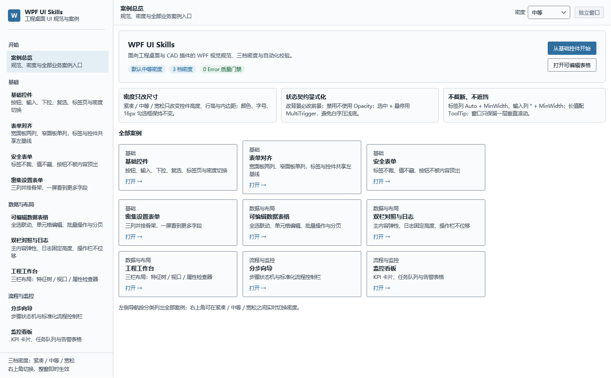
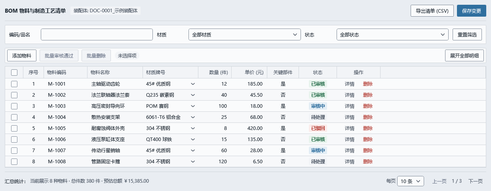
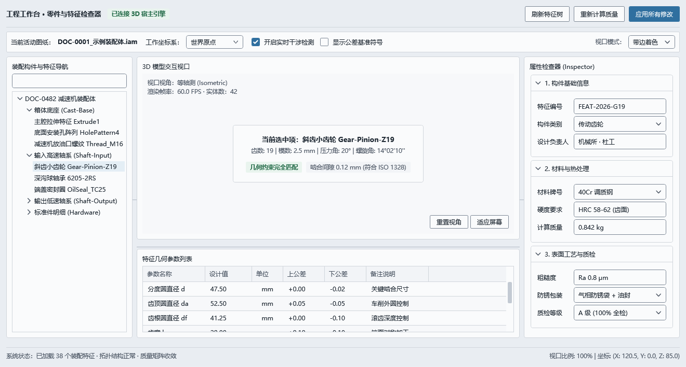
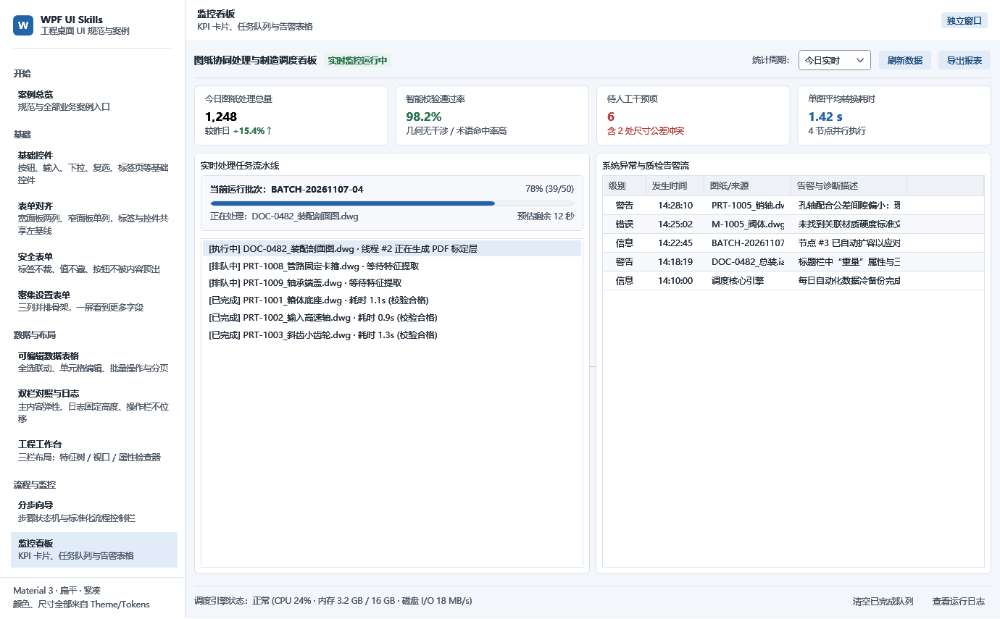
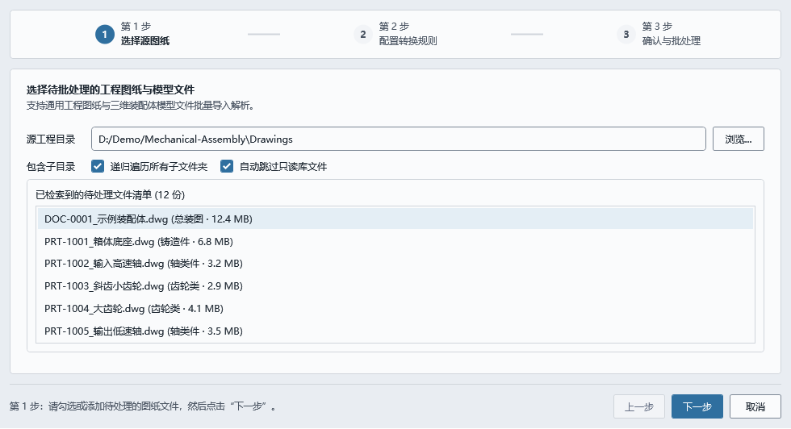
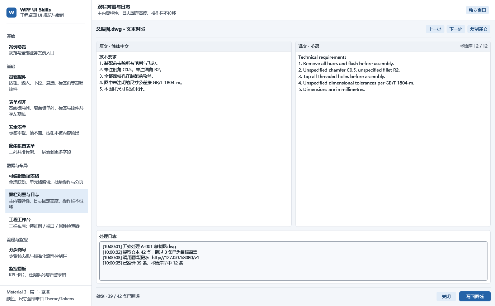
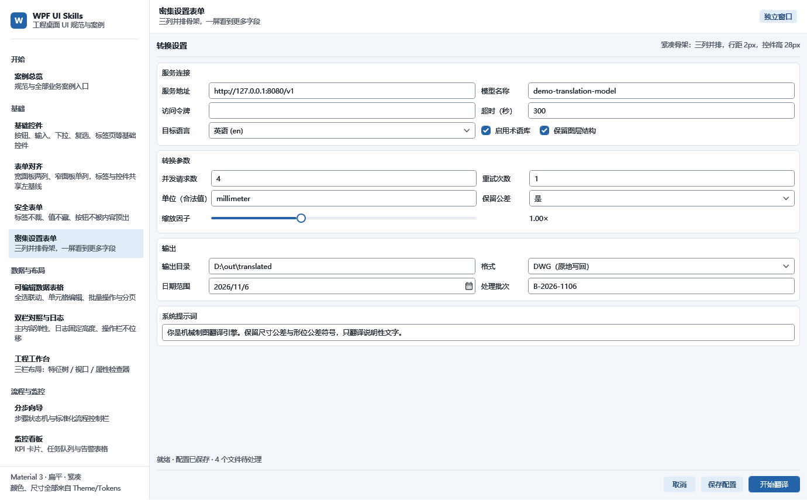

<h1 align="center">WPF UI Skills</h1>

<p align="center">面向桌面工具与工程插件的 WPF/XAML 视觉规范、三档密度主题、AI 编码技能与自动化校验工具集。</p>

<p align="center">
  <a href="./README.md">English</a> | <a href="./README.zh-CN.md">简体中文</a>
</p>

<p align="center">
      <a href="./docs/README.md"></a>
</p>

`wpf-ui-style` 将可直接合并的 WPF 资源字典、显式前景/背景状态契约、防截断布局规范、可运行案例中心以及静态/运行时质量门禁整合在同一仓库中，既可作为业务项目的 WPF 主题直接使用，也可作为 AI 编码代理技能（`SKILL.md`）一键安装到主流开发客户端。

## 核心亮点

| 特性 | 价值说明 |
|---|---|
| 三档密度体系（紧凑 / 中等 / 宽松） | 通过 `{DynamicResource Layout.*}` 统一调节控件高度（26 / 30 / 34 px）、表格行高（24 / 28 / 32 px）与内边距，不改变颜色与字号，支持运行时热切换。 |
| 显式状态契约与 WCAG AA 对比度 | 每次状态切换必须同时声明 `Background` 与 `Foreground`，禁止用 `Opacity` 表达禁用态，由 `tools/ContrastCheck.py` 校验正文 >= 4.5:1、边框/图标/禁用文字 >= 3:1。 |
| 防截断与防高度跳变布局规范 | 避免标签被裁切、多行输入撑满网格、输入框右侧空白不可点击以及 `SizeToContent="Height"` 窗口切换 Tab 导致高度跳变，由 `tools/LayoutCheck.py` 自动扫描。 |
| 可运行案例中心与参考骨架 | `preview/` 内置 10 个交互式 `UserControl` 案例页，`samples/` 提供分类可复制窗口骨架，支持离屏渲染 PNG 与高 DPI 倍率验证。 |
| 自动化验证流水线与多客户端安装器 | 整合 Python 3 标准库静态检查、xUnit 契约测试（`tests/WpfStyleContractTests.csproj`）、UI 点击状态机测试（`tools/UiTest.py`）以及面向主流 AI 客户端的 `install.ps1`。 |
| 零第三方 UI 控件依赖 | 仅依赖标准 WPF 基础控件，同时兼容 .NET Framework 4.8 与 .NET 8+，适用于独立桌面工具和宿主内嵌工程插件。 |

## 架构概览

```text
┌────────────────────────────────────────────────────────────────────────────┐
│                        AI 技能与规范层 (Skill & Docs)                       │
│   SKILL.md   │   install.ps1   │   docs/   │   references/   │   samples/  │
└────────────────────────────────────┬───────────────────────────────────────┘
                                     │ 指导与配置
                                     ▼
┌────────────────────────────────────────────────────────────────────────────┐
│                         主题资源层 (Theme/)                                 │
│  Theme.xaml / Theme.Compact.xaml / Theme.Relaxed.xaml                      │
│    Tokens.xaml ──▶ Controls / DataControls / Icons / Extras ──▶ Density.*  │
└───────────────────┬───────────────────────────────────────┬────────────────┘
                    │ 通过 ResourceDictionary 链接           │ 接受校验
                    ▼                                       ▼
┌───────────────────────────────────────┐   ┌────────────────────────────────┐
│       可运行案例中心 (preview/)        │   │       自动化验证门禁            │
│  MainWindow + CaseCatalog (10 案例页) │◀──│  LayoutCheck.py (XAML 规则)    │
│  DensitySwitcher + UiTestEngine       │   │  ContrastCheck.py (WCAG AA)    │
│  离屏渲染 PNG 与交互点击测试运行器      │   │  UiTest.py + xUnit tests/      │
└───────────────────────────────────────┘   └────────────────────────────────┘
```

- **资源合并顺序**：`Tokens.xaml` 提供唯一色值、字体、圆角与中等密度兜底值；各控件字典（`Controls.xaml`、`DataControls.xaml`、`Icons.xaml`、`Extras.xaml`）通过 `{DynamicResource Layout.*}` 读取尺寸；`Density.*.xaml` 放在最后合并，确保所选密度档位优先命中。

## 使用示例

可运行案例中心（`preview/`）直接链接根目录 `Theme/`，用于集中展示各类工程布局、控件交互状态与实时密度切换效果。

启动交互式案例中心或离屏导出 PNG：

```bash
dotnet run --project preview
dotnet run --project preview -- -window home -page workbench
dotnet run --project preview -- -window editable-table -density Compact -shot out/table.png -scale 1.5
```

### 案例中心总览与导航

侧边分类导航、规范摘要与实时密度热切换（紧凑 26 px / 中等 30 px / 宽松 34 px）。



### 复杂可编辑数据表格与批量操作

表头全选与行勾选双向联动、单元格单次点击就地编辑与下拉选择、数值右对齐、状态徽章、展开明细行，以及零选中时批量危险按钮保持中性禁用态。



### 三栏工程工作台与装配树

左侧特征树与快速过滤、中间视口与参数表格（带 `GridSplitter` 弹性分割）、右侧属性检查器与底部状态栏。



### 工况监控看板与多步骤向导

4 组 KPI 指标卡片与实时任务队列/告警表格（`dashboard`），以及采用单层内容面板切换、规避多 Tab 高度跳变的分步工程向导（`wizard`）。

| 工况监控看板（`dashboard`） | 多步骤工程向导（`wizard`） |
|---|---|
|  |  |

### 双栏差异比对与密集参数设置

左右独立滚动对照与固定高度只读日志流（`compare`），以及三列紧凑网格参数设置表单（`settings`）。

| 双栏差异比对（`compare`） | 密集参数设置（`settings`） |
|---|---|
|  |  |

## 快速安装

### 环境要求

- **WPF 应用与预览工程**：Windows 系统，.NET Framework 4.8 或 .NET 8+ SDK（`preview/WpfStylePreview.csproj` 目标框架为 `net8.0-windows`，`tests/WpfStyleContractTests.csproj` 目标框架为 `net8.0`）。
- **自动化校验脚本**：Python 3（仅使用标准库，无需 `pip install`）；PowerShell 薄包装 `.ps1` 会自动探测 `py -3`、`python3` 或 `python`。
- **技能安装脚本**：PowerShell（`pwsh` 或 Windows PowerShell），零外部依赖。

### 方式一：作为 AI 编码技能安装

克隆仓库后运行 `install.ps1`，将 `wpf-ui-style` 安装到本机检测到的 AI 编码客户端，或写入目标项目的团队共享目录：

```powershell
git clone https://github.com/zly258/wpf-ui-style.git
cd wpf-ui-style

pwsh ./install.ps1 -Detect
pwsh ./install.ps1 -Scope Global -Clients auto
```

项目级安装（可提交给团队共享）：

```powershell
pwsh ./install.ps1 -Scope Project -Root "D:/Demo/YourApp" -Clients all
```

支持的客户端列表、规则文件回退机制、残留清理参数与卸载方式见 [INSTALL.md](./INSTALL.md)。

### 方式二：直接接入业务 WPF 主题

将 `Theme/` 复制到目标 WPF 项目中，或参照 [preview/WpfStylePreview.csproj](./preview/WpfStylePreview.csproj) 通过 `Link` 链接共享程序集内的主题文件，随后在资源字典中合并 `Theme/Theme.xaml`。

## 快速上手

### 1. 合并主题资源字典

在常规 WPF 应用的 `App.xaml` 中合并：

```xml
<Application.Resources>
    <ResourceDictionary>
        <ResourceDictionary.MergedDictionaries>
            <ResourceDictionary
                Source="pack://application:,,,/YourAssembly;component/Theme/Theme.xaml" />
        </ResourceDictionary.MergedDictionaries>
    </ResourceDictionary>
</Application.Resources>
```

在没有 `App.xaml` 的工程插件中，在窗口构造函数的 `InitializeComponent()` 之前合并：

```csharp
public static void Apply(Window window)
{
    window.Resources.MergedDictionaries.Add(new ResourceDictionary
    {
        Source = new Uri(
            "pack://application:,,,/YourAssembly;component/Theme/Theme.xaml",
            UriKind.Absolute)
    });
}
```

请将 `YourAssembly` 替换为实际包含 `Theme/` 文件的程序集名称。

### 2. 使用隐式样式与显式变体

基础控件（`Button`、`TextBox`、`PasswordBox`、`ComboBox`、`CheckBox`、`RadioButton`、`GroupBox`、`TabControl`、`ListBox`、`DataGrid`、`TreeView` 等）均已定义隐式样式，无需逐一指定；仅变体样式需要显式声明 `Style`：

```xml
<Button Content="保存" Style="{StaticResource Button.Primary}" />
<Button Content="取消" />
<TextBox Text="{Binding Name}" />
<GroupBox Header="翻译选项">
    <StackPanel>
        <CheckBox Content="启用术语库" />
        <ComboBox SelectedIndex="0">
            <ComboBoxItem Content="替换原文" />
            <ComboBoxItem Content="追加译文" />
        </ComboBox>
    </StackPanel>
</GroupBox>
```

### 3. 选择或切换密度（可选）

默认 `Theme.xaml` 为中等密度；如需在启动时切换档位，直接将入口替换为 `Theme.Compact.xaml` 或 `Theme.Relaxed.xaml`。如需在运行时热切换：

```csharp
Application.Current.Resources.MergedDictionaries.Add(new ResourceDictionary
{
    Source = new Uri(
        "pack://application:,,,/YourAssembly;component/Theme/Density.Compact.xaml",
        UriKind.Absolute)
});
```

### 4. 运行自动化验证流水线

修改主题或业务 XAML 后，依次执行以下检查：

```bash
python tools/LayoutCheck.py --root . --theme-dir Theme
python tools/ContrastCheck.py
dotnet test tests/WpfStyleContractTests.csproj
dotnet build preview/WpfStylePreview.csproj
python tools/UiTest.py --all --test-clicks
```

## 常用命令

| 用途 | 命令 | 说明 |
|---|---|---|
| 探测本机 AI 客户端 | `pwsh ./install.ps1 -Detect` | 列出已安装的客户端与残留技能目录 |
| 全局安装技能 | `pwsh ./install.ps1 -Scope Global -Clients auto` | 仅安装到真实存在的客户端并清理残留 |
| 清理已卸载客户端残留 | `pwsh ./install.ps1 -Cleanup` | 只删除本技能写入的文件 |
| 静态布局与令牌检查 | `python tools/LayoutCheck.py --root . --theme-dir Theme` | 发现错误返回非零退出码；加 `--strict` 将警告也判为失败 |
| WCAG 对比度检查 | `python tools/ContrastCheck.py` | 校验 `Theme/Tokens.xaml` 中关键前景/背景组合的对比度 |
| PowerShell 校验包装脚本 | `pwsh ./tools/LayoutCheck.ps1 -Root "D:/Demo/YourApp"` | 自动探测 `py -3` / `python3` / `python`；`ContrastCheck.ps1` 同理 |
| 运行 xUnit 契约测试 | `dotnet test tests/WpfStyleContractTests.csproj` | 校验主题令牌与样式契约不变式 |
| 启动案例中心 | `dotnet run --project preview` | 支持 `-window`、`-page`、`-density`、`-shot`、`-scale`、`-all` |
| 运行交互点击状态测试 | `python tools/UiTest.py --all --test-clicks` | 离屏渲染界面、模拟点击并断言状态迁移 |
| 离屏渲染单个 XAML | `python tools/UiTest.py --xaml preview/Views/SafeFormView.xaml --shot .tmp-shots/verify.png` | 动态加载并导出指定 XAML 视图为 PNG |

## 配置与集成

### 三档密度令牌对照

三档密度仅改变控件尺寸、内边距与行高；颜色、字号、圆角以及 16 px 的 `CheckBox`/`RadioButton` 靶心尺寸在各档位下保持一致。

| 令牌 | 紧凑 | 中等（默认） | 宽松 |
|---|---:|---:|---:|
| `Layout.ControlHeight` | 26 | 30 | 34 |
| `Layout.ControlHeight.Small` | 24 | 26 | 30 |
| `Layout.RowHeight` | 24 | 28 | 32 |
| `Layout.HeaderHeight` | 26 | 30 | 34 |
| `Layout.TabPadding` | 10,4 | 12,6 | 16,8 |
| `Layout.ButtonPadding` | 10,0 | 12,0 | 16,0 |
| `Layout.WindowPadding` | 8 | 12 | 16 |
| `Layout.FormRowMargin` | 0,2 | 0,3 | 0,5 |

### 核心硬规则摘要

- **改背景必配前景**：触发器修改 `Background` 时，必须在同一触发器中显式声明 `Foreground`（以及所需的 `BorderBrush`）。
- **禁用态严禁 `Opacity`**：统一使用 `Brush.Control.Disabled`、`Brush.Text.Disabled` 与 `Brush.Border`，避免对比度崩塌。
- **隐式 `TextBlock` 继承前景**：全局隐式 `TextBlock` 绑定至最近父级 `(TextElement.Foreground)`，防止覆盖 `Button.Primary` 的白色文字。
- **白字仅用于深色背景**：仅允许出现在 `Accent*`、`Danger*` 与 `Tooltip.Background`；列表/下拉框悬停与选中统一采用浅底深字，并以 `MultiTrigger` 处理选中+悬停组合态。
- **业务 XAML 严禁硬编码字面量**：统一引用 `Brush.*`、`FontSize.*` 与 `Layout.*` 令牌，禁止散落 `#RRGGBB`、局部 `FontFamily` 或固定控件高度。
- **防截断与稳定页签**：标签列用 `Auto` + `MinWidth`，输入列用 `*` + `MinWidth`，任何省略号文本必须配 `ToolTip`；`SizeToContent="Height"` 窗口内的 `TabControl` 必须固定 `Height`。

## 文档导航

| 主题 | 内容说明 | 链接 |
|---|---|---|
| 技能安装与客户端配置 | 安装参数、支持的 AI 客户端路径、验证方法与卸载步骤 | [INSTALL.md](./INSTALL.md) |
| AI 代理执行规范 | 强制规则 R1-R17、令牌速查、验证流水线与交付自查清单 | [SKILL.md](./SKILL.md) |
| 主题接入说明 | 资源字典职责、合并顺序、插件加载器示例与常见问题排查 | [Theme/README.md](./Theme/README.md) |
| 文档总索引 | 完整规范文档清单与常用验证命令 | [docs/README.md](./docs/README.md) |
| 设计令牌 | 色值、字体阶梯、间距与圆角定义 | [docs/01-design-tokens.md](./docs/01-design-tokens.md) |
| 控件状态矩阵 | Normal、Hover、Pressed、Focused、Selected 与 Disabled 令牌组合 | [docs/02-control-states.md](./docs/02-control-states.md) |
| 布局规范 | 防截断表单、宽窄面板对齐、滚动保护与标签页规范 | [docs/03-layout.md](./docs/03-layout.md) |
| 常见错误与修复 | 高频 WPF 样式与布局问题对照排查 | [docs/04-common-pitfalls.md](./docs/04-common-pitfalls.md) |
| 对比度与可访问性 | WCAG 实测对比度比值与配色约束 | [docs/05-accessibility-contrast.md](./docs/05-accessibility-contrast.md) |
| 三档密度体系 | 紧凑、中等、宽松档位键集与运行时热切换方式 | [docs/06-density.md](./docs/06-density.md) |
| 测试与验证 | 静态脚本、xUnit 契约测试与人工回归矩阵 | [docs/07-testing.md](./docs/07-testing.md) |
| 矢量图标系统 | 24x24 Material Symbols 几何契约与图标按钮规范 | [docs/09-icon-system.md](./docs/09-icon-system.md) |
| 速查表与 XAML 片段 | 一页速查表与可直接复制的 XAML 代码片段 | [references/cheatsheet.md](./references/cheatsheet.md) / [references/xaml-snippets.md](./references/xaml-snippets.md) |
| 参考案例与预览工程 | 分类 XAML 窗口骨架与案例中心命令行参数 | [samples/README.md](./samples/README.md) / [preview/README.md](./preview/README.md) |
| 自动化脚本说明 | 脚本分工、退出码与 `LayoutCheck` / `UiTest` 参数说明 | [tools/README.md](./tools/README.md) |
| 第三方归属说明 | `Theme/Icons.xaml` 中 Google Material Symbols 的 Apache 2.0 声明 | [NOTICE.md](./NOTICE.md) |
